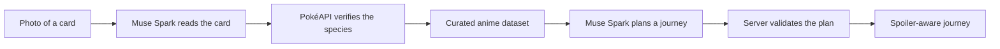

# PokéVerse

**Every card has a story.** PokéVerse connects a physical Pokémon trading card to the anime episodes behind the Pokémon on it. Scan a card, confirm who is on it, and get a spoiler-aware viewing journey built only from episodes we can cite.

Built for the Meta Global AI Developer Hackathon with Next.js, TypeScript and Meta's Muse Spark model.

> Live demo, screenshots and demo video: see [Demo](#demo). The links are placeholders until they are added.

## Contents

- [The problem](#the-problem)
- [The solution](#the-solution)
- [Features](#features)
- [Technology stack](#technology-stack)
- [Running locally](#running-locally)
- [Deployment](#deployment)
- [Demo](#demo)
- [How the AI is kept honest](#how-the-ai-is-kept-honest)
- [Documentation](#documentation)
- [Limitations and future work](#limitations-and-future-work)
- [Attribution](#attribution)

## The problem

Collecting Pokémon cards and watching the Pokémon anime are two parts of the same hobby, but they rarely meet. Holding a card of Gengar or Umbreon, a fan may want to know where that Pokémon appeared in the anime and which episodes are worth watching first. Answering that today means identifying the card, finding an episode list, and cross-checking it by hand across several sites. A new viewer also has to avoid spoilers while doing it.

PokéVerse is aimed at fans who collect cards and want to explore the anime behind them, including newer fans who do not know where to start. Pokémon databases and card tools already cover a lot of this ground. This project does not claim that nothing like it exists. It focuses on one specific path: from a photo of a card to a cited, spoiler-aware watch plan.

### Why this project exists

PokéVerse began as an entry for the Meta Global AI Developer Hackathon. The question it explores is whether a multimodal model can bridge two things fans already enjoy, physical cards and anime episodes, without making things up. That second half drove most of the engineering: the model is used where it is strong (reading a photo, writing a friendly explanation), and everything it says about a Pokémon or an episode is checked against PokéAPI or a curated, cited dataset.

<!-- TODO(author): add one or two sentences of personal motivation here. -->

## The solution

PokéVerse follows one pipeline, and each stage is checked by something other than the AI.



1. **Explore** any Pokémon through [PokéAPI](https://pokeapi.co): artwork, types, stats, evolutions.
2. **Scan** a card photo. Meta Muse Spark reads the card and proposes a species name plus whatever card details are legible.
3. **Verify** the species against PokéAPI. Only a species PokéAPI recognises is shown as confirmed, and card details read by the model are labelled unverified.
4. **Discover** verified anime appearances and related Pokémon from a hand-curated, source-linked dataset.
5. **Plan** a journey. Muse Spark chooses episodes from the dataset for the Pokémon, viewing time, spoiler setting and interests you pick. The server checks every episode ID, orders the result, and renders all facts from the dataset.

## Features

All features below are implemented and running in this repository.

**Pokémon explorer** (`/explore`)
Search by name or Pokédex number across all Pokémon from PokéAPI. The page takes on the colour theme of the Pokémon's type.

**Pokémon profiles** (`/pokemon/[name]`)
Official artwork, types, height, weight, abilities, base stats, Pokédex entry and evolution line. A featured-episodes block links into the story page and the journey planner.

**Card scanner** (`/scan`)
Upload a photo or take one on a phone. The image is downscaled in the browser, validated on the server, and read by Muse Spark. The result shows the verified Pokémon (artwork, types, Pokédex number), card details labelled as unverified, and a confidence note. If the scan is wrong, you can search PokéAPI and correct it. Uploaded images are not stored.

**Anime Story Explorer** (`/pokemon/[name]/story`)
For Pokémon in the dataset: a "Start here" set of featured episodes, a full timeline in broadcast order, and connected Pokémon that share a verified episode. Every card links to its source.

**Spoiler protection**
Each episode record separates a premise (always safe) from plot outcomes (each marked mild or major). The viewer chooses **No spoilers** (default), **Mild spoilers**, or **Everything**. Hidden outcomes show as a lock badge. The story page and journey results follow the setting you choose; the previews on profiles and scan results have no setting and always hide outcomes.

**AI Story Journey Planner** (`/journey`)
Pick one to five Pokémon, a viewing budget (30 minutes, 1 hour or 2 hours), a spoiler preference and optional interests. Muse Spark selects episodes. The server validates the answer and returns a titled journey with an ordered timeline, a reason for each episode, transitions between chapters, and source links.

**Multi-Pokémon recommendations**
An episode featuring several selected Pokémon is counted once. Connections between Pokémon are shown only when the dataset lists both in the same episode. If your Pokémon share no episode, the journey says so.

**Rate limiting and API security**
Per-visitor limits and one app-wide daily budget for Meta requests, stored in Upstash Redis. If Redis is unavailable in production, AI requests are refused rather than left unmetered. The API key never reaches the browser. See [How the AI is kept honest](#how-the-ai-is-kept-honest) and [`docs/ARCHITECTURE.md`](docs/ARCHITECTURE.md).

**Collection (device-only)**
After a successful scan, **Save to Collection** stores the *verified* species id and name in your browser's `localStorage` (key `pokeverse:collection:v1`). Unverified AI-read card details (card name, number, set) are never saved. The `/collection` page shows your saved Pokémon with artwork and types fetched from PokéAPI, prevents duplicates, lets you remove Pokémon, and offers **Build a Story Journey**, which preselects up to five saved Pokémon that have verified anime episodes. The collection lives only in the current browser on the current device: it does not sync across devices or browsers, and clearing site data erases it. If storage is blocked (for example in private browsing) the page and the save button explain this instead of failing. There are no accounts and no server-side storage.

## Technology stack

Taken from [`package.json`](package.json) and the source.

| Area | Technology |
| --- | --- |
| Framework | Next.js 16.4.3 (App Router, Cache Components, Server Components, Route Handlers, a Server Action) |
| UI | React 19.3.0, Tailwind CSS 4 (via `@tailwindcss/turbopack`), Nunito through `next/font/google` |
| Language | TypeScript 5 |
| AI | Meta Model API, model `muse-spark-1.3`, called through the `openai` SDK (^7.47.0) against `https://api.meta.ai/v1` using the Responses API |
| Pokémon data | [PokéAPI](https://pokeapi.co) over `fetch`, cached with `use cache` |
| Anime data | Curated TypeScript dataset in `data/anime/` |
| Rate limiting | Upstash Redis over its REST API, called with `fetch` (no SDK) |
| Hosting | Vercel |
| Tooling | ESLint 9 with `eslint-config-next` |

The only runtime dependencies are `next`, `react`, `react-dom` and `openai`.

## Running locally

**Requirements:** Node.js 20.9 or newer (Next.js 16 requirement), npm, and a Meta Model API key.

```bash
git clone <your-repository-url>
cd pokeverse
npm install
cp .env.example .env.local
# edit .env.local and add your MODEL_API_KEY
npm run dev
```

Open <http://localhost:3000>.

### Environment variables

Copy [`.env.example`](.env.example) to `.env.local`. Never commit real values; `.env*` is git-ignored, with `.env.example` as the only exception.

| Variable | Required | Purpose |
| --- | --- | --- |
| `MODEL_API_KEY` | Yes, for scanning and journeys | Meta Model API key. Read only on the server. |
| `UPSTASH_REDIS_REST_URL`, `UPSTASH_REDIS_REST_TOKEN` | Yes in production; optional locally | Shared rate-limit and daily-budget store. `KV_REST_API_URL` and `KV_REST_API_TOKEN` (set by the Vercel Upstash integration) are also accepted. |
| `AI_DAILY_CALL_LIMIT` | Optional | App-wide maximum Meta requests per UTC day, shared by scans and journeys. Unset means 500. `0` disables AI. An invalid value disables AI. |

Locally (when `NODE_ENV` is not `production`) the app falls back to an in-memory counter if Redis is not configured, so you can develop without Upstash. Browsing, exploring and the story pages need no API key.

### Commands

These match the scripts in `package.json`.

| Command | What it does |
| --- | --- |
| `npm run dev` | Start the development server |
| `npm run build` | Production build (also type-checks) |
| `npm run start` | Serve the production build |
| `npm run lint` | Run ESLint |
| `npx tsc --noEmit` | Type-check only (not an npm script) |

In development only, `GET /api/ai/test` sends one fixed prompt to Muse Spark so you can confirm your key works. It returns 404 in production.

## Deployment

PokéVerse is designed for Vercel with an Upstash Redis database.

1. Import the repository into Vercel.
2. Set `MODEL_API_KEY` in the project's environment variables.
3. Create an Upstash Redis database, or add the Upstash integration from the Vercel Marketplace, and set `UPSTASH_REDIS_REST_URL` and `UPSTASH_REDIS_REST_TOKEN` (or let the integration set `KV_REST_API_URL` and `KV_REST_API_TOKEN`).
4. Set `AI_DAILY_CALL_LIMIT` to the number of Meta requests per day you are willing to pay for.
5. Add the same variables to the Preview environment if preview deployments should support AI features.
6. After deploying, try one scan and one journey, then confirm a key named like `pokeverse:ai-daily:<YYYY-MM-DD>` appears in Redis with a count that rises.

Security requirements:

- Keep `MODEL_API_KEY` server-side. It has no `NEXT_PUBLIC_` prefix and must never get one.
- Without Redis configured, production AI endpoints return 503 by design. A wrong URL or token disables AI the same way.
- The app has no authentication, so any visitor can use the daily budget. The daily cap is the spending safeguard.

## Demo

| Item | Link |
| --- | --- |
| Live deployment | `TODO: add the verified Vercel URL` |
| Screenshots | `TODO: add images, for example docs/screenshots/*.png` |
| Demo video | `TODO: add the video URL` |

## How the AI is kept honest

The model is used for reading images and for choosing and describing episodes. It is not trusted for facts.

- **Species are verified.** A name from the model becomes a confirmed Pokémon only after PokéAPI recognises it. Card number and set are shown as unverified.
- **Episodes are grounded.** The planner only sees curated episode records. Every episode ID it returns is checked against the dataset, and invented or duplicate IDs are removed. Titles, episode numbers and source links always come from the dataset.
- **Order is deterministic.** After validation, the server sorts steps into broadcast order and applies the time budget itself.
- **Spoilers are filtered twice.** Hidden outcomes are removed before the prompt is built and are blanked in the response. The model's prose is then checked, and replaced with the dataset's own premise text if it looks risky.
- **Spending is capped.** One shared daily budget covers every Meta request, and the app refuses requests if it cannot count them.

The details, and which of these protections are tested versus best-effort, are in [`docs/ARCHITECTURE.md`](docs/ARCHITECTURE.md).

## Documentation

- [`docs/ARCHITECTURE.md`](docs/ARCHITECTURE.md): system design, data flows, security model and verification status
- [`docs/ADR.md`](docs/ADR.md): the major design decisions and their trade-offs

## Limitations and future work

**Limitations**

- **Small dataset.** The curated dataset has 11 episodes covering 12 Pokémon species (Pikachu, Gastly, Haunter, Gengar, Eevee and its seven evolutions Vaporeon, Jolteon, Flareon, Espeon, Umbreon, Leafeon and Glaceon). Most Pokémon have no verified episodes yet, and journeys are often short. The planner says so when it is true.
- **Estimated runtimes.** Verified runtimes are not stored. Journeys assume about 25 minutes per episode for planning only.
- **Episode data.** Episodes were checked against [Serebii.net](https://www.serebii.net) episode guides, and episode numbers are Serebii's overall numbering, not per-season numbers. Air dates are not recorded. Other sites number some episodes differently.
- **AI recognition can be wrong.** It was tried on a small number of official card images. Glare, foil, damaged cards and non-English cards have not been systematically tested. Treat the confidence note and the "Not right?" correction as part of the feature. One card per scan.
- **Spoiler filtering is partly heuristic.** Dataset text is separated by design and its protection is exact. Checking the model's free-text wording relies on word lists and pattern checks, so it can block safe text (it then falls back to dataset wording) and cannot guarantee it catches every possible paraphrase.
- **Tests cover accessibility and UI behaviour, not the AI or data logic.** `npm run test:a11y` (Playwright + axe, with mocked AI routes) and `npm run test:contrast` are in the repository; there are no unit tests for the planner, scanner or dataset, and earlier verification of those used uncommitted scripts. See [`docs/ARCHITECTURE.md`](docs/ARCHITECTURE.md#verification-status).
- **The collection is local to one browser.** It does not sync across devices, has no accounts or backup, holds at most 200 Pokémon, and is lost if the user clears site data.

**Future work**

- Grow the dataset with more verified episodes and Pokémon.
- Add an automated test suite and CI.
- Optional accounts so the collection and journeys can sync across devices.
- Add verified runtimes and air dates.
- Support several cards per scan.
- Add per-token cost accounting, not just a request count.

## Attribution

PokéVerse is an unofficial fan project and is not affiliated with Nintendo, Creatures Inc., GAME FREAK, or The Pokémon Company. Pokémon and Pokémon character names are trademarks of their respective owners.

- **[PokéAPI](https://pokeapi.co)** supplies Pokémon data. Official artwork is hotlinked from the PokéAPI sprites repository and is not stored in this repository.
- **[Meta Model API](https://dev.meta.ai)** and the Muse Spark model power card reading and journey planning.
- **[Serebii.net](https://www.serebii.net)** episode guides were the source for the episode records. The summaries in this project are written in our own words and each record links to its source page.
- Typeface: Nunito, loaded through `next/font/google`.

No license has been added to this repository yet.
