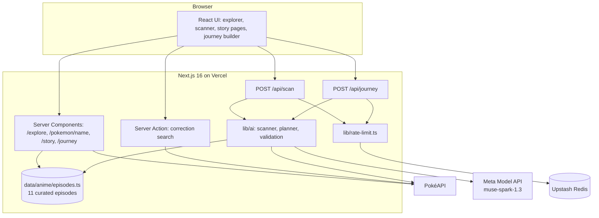
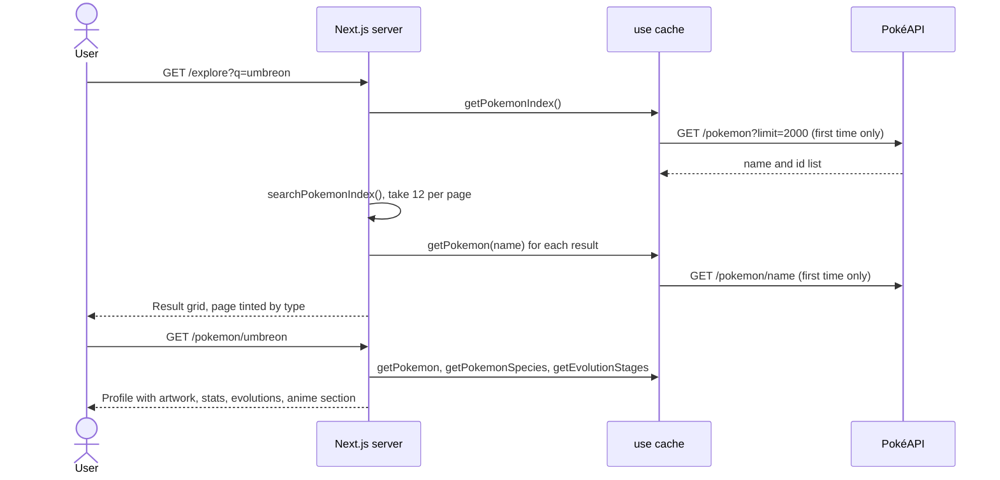
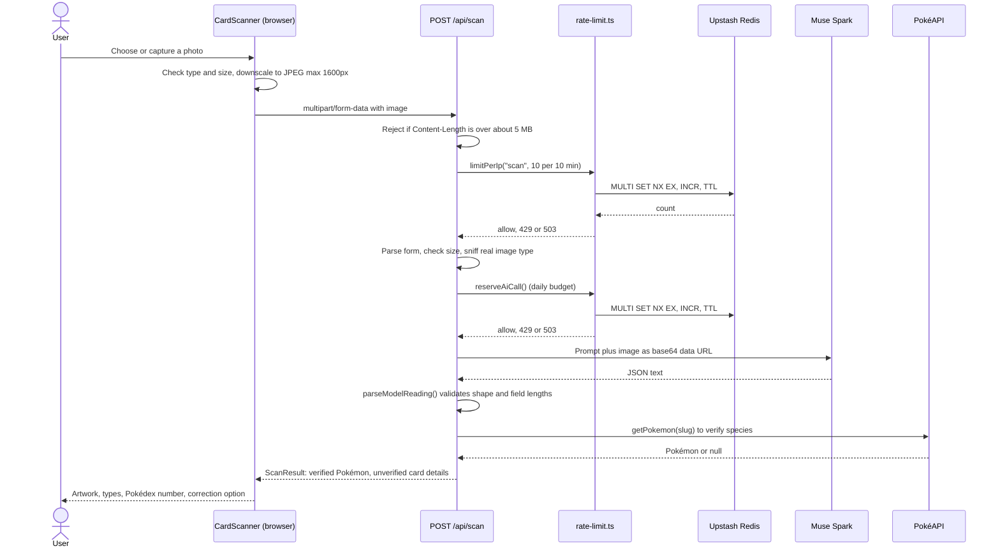
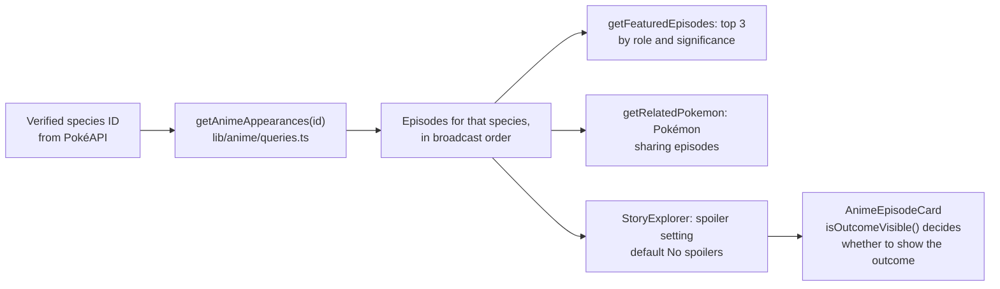
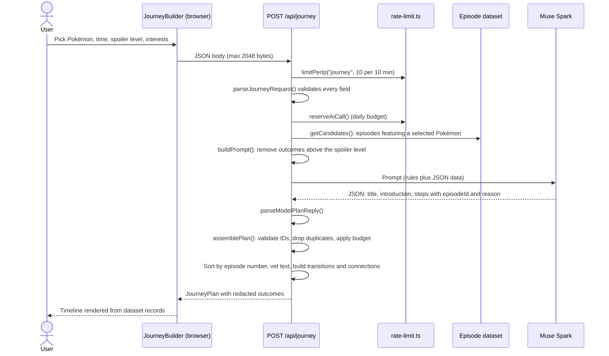
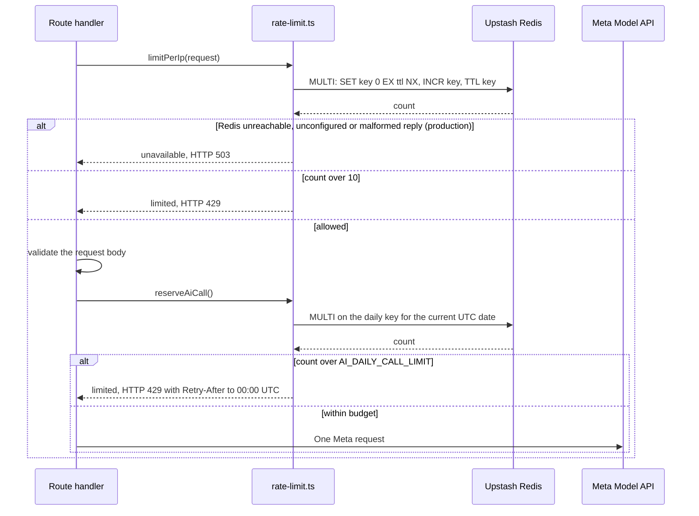

# PokéVerse architecture

This document explains how PokéVerse works as it is implemented today. It describes the code in this repository, not the original plan. Statements about what has been tested are collected in [Verification status](#verification-status), and anything that is best-effort is labelled as such.

## Contents

1. [High-level architecture](#high-level-architecture)
2. [Project structure](#project-structure)
3. [Main data flows](#main-data-flows)
4. [Technical details](#technical-details)
5. [Verification status](#verification-status)
6. [Known gaps](#known-gaps)

## High-level architecture

PokéVerse is a single Next.js application (App Router). The browser talks only to the Next.js server. The server talks to three outside services: PokéAPI for Pokémon facts, the Meta Model API for the Muse Spark model, and Upstash Redis for shared counters. The anime dataset is not a service. It is a TypeScript module compiled into the application.



| Part | Role |
| --- | --- |
| Frontend | React 19 components styled with Tailwind CSS 4. Interactive parts are Client Components; the rest render on the server. |
| Server-side Next.js | Server Components fetch Pokémon data and render pages. Two Route Handlers (`/api/scan`, `/api/journey`) run all AI work. One Server Action serves the scanner's correction search. |
| Meta Model API | Reads card photos and plans journeys. Called only from server code, through the `openai` SDK against `https://api.meta.ai/v1` using the Responses API. |
| PokéAPI | Source of truth for Pokémon species, types, artwork, stats and evolutions. Also used to verify the species the model names. |
| Curated anime dataset | Source of truth for episodes. Everything the app says about an episode comes from here. |
| Upstash Redis | Shared counters for per-visitor rate limits and the app-wide daily Meta budget. |
| Vercel | Hosts the app. Serverless instances share no memory, which is why counters live in Redis. |

## Project structure

Only files that exist in the repository are listed.

```text
app/
  layout.tsx                  Root layout, Navbar, Footer, metadata
  page.tsx                    Landing page
  explore/page.tsx            Search and paginate Pokémon (Server Component)
  pokemon/[name]/page.tsx     Pokémon profile
  pokemon/[name]/story/page.tsx   Anime Story Explorer page
  scan/page.tsx               Renders <CardScanner />
  scan/actions.ts             Server Action: searchPokemonForCorrection
  collection/actions.ts       Server Action: getCollectionPokemon (validates saved ids, read-only PokéAPI lookup)
  journey/page.tsx            Loads Pokémon data, renders <JourneyBuilder />
  collection/page.tsx         Renders <CollectionView /> (device-only collection)
  api/scan/route.ts           POST: card scan endpoint
  api/journey/route.ts        POST: journey planning endpoint
  api/ai/test/route.ts        GET: dev-only Meta connectivity check (404 in production)
  error.tsx, not-found.tsx    Error and not-found UI

components/
  CardScanner.tsx             Upload, preview, scan, result, correction (client)
  JourneyBuilder.tsx          Pokémon picker, preferences, results (client)
  StoryExplorer.tsx           Spoiler setting + Start here + timeline (client)
  AnimeEpisodeCard.tsx        Renders one episode; enforces the spoiler setting
  AnimeFeatured.tsx           Featured episodes and links to story/journey
  AnimeTimeline.tsx, StoryTimeline.tsx   Timeline rendering
  TypeTheme.tsx, PokemonCard.tsx, PokemonArtwork.tsx, ...   UI building blocks

data/anime/
  episodes.ts                 The curated episode records (ANIME_EPISODES)
  pokemon.ts                  Display names and slugs for species in the dataset

lib/ai/
  meta-client.ts              The only code that calls Meta; reads MODEL_API_KEY
  card-scan.ts                Scan types, prompt, reply parsing, upload sniffing
  card-scanner.ts             scanCard(): Muse Spark read + PokéAPI verification
  journey.ts                  Request validation, prompt building, plan assembly
  journey-planner.ts          planJourney(): calls Muse Spark and assemblePlan
  contracts.ts                Journey data contracts (and unused scan contracts)
lib/anime/
  types.ts                    Episode and spoiler types
  queries.ts                  getAnimeAppearances, getFeaturedEpisodes, spoiler helpers
lib/pokeapi/
  client.ts, pokemon.ts, types.ts, format.ts   Cached PokéAPI access and mapping
lib/rate-limit.ts             Per-IP limits and the global daily AI budget
lib/theme/type-themes.ts      Type-based colour themes
```

## Main data flows

### A. Pokémon exploration

Explore and profile pages are Server Components. PokéAPI calls are wrapped in functions marked `use cache` with `cacheLife("days")`, so repeat visits do not hit PokéAPI.



Failure behaviour: a PokéAPI outage on the search page throws and is shown by `app/error.tsx`. On a profile, species and evolution failures are caught and the rest of the page still renders. A name PokéAPI does not know shows the not-found UI.

### B. Card scanning



The model's answer is never shown as fact. Only `verification: "verified"` (PokéAPI found the species) produces a confirmed Pokémon. Card name, number and set come from the model and are labelled unverified. If the model reports "not a Pokémon card", names nothing, or names something PokéAPI does not have, the UI says so and offers a name search instead of guessing.

### C. Anime discovery

The link between PokéAPI and the anime dataset is the National Dex **species ID** (`Pokemon.speciesId`), never a display name.



`/pokemon/[name]/story` loads the Pokémon from PokéAPI, calls the query functions, and passes the episodes to `StoryExplorer`, a Client Component that owns the spoiler setting. It passes the same setting to both "Start here" and the timeline. Profile and scanner previews have no setting control, so they always use "No spoilers".

### D. AI Story Journey



What `assemblePlan` does, in order (see `lib/ai/journey.ts`):

1. Look up every returned `episodeId` in the candidate set. Unknown IDs and repeats are dropped and counted.
2. Keep at most `floor(budget / 25)` episodes (1, 2 or 4 for 30, 60 or 120 minutes), then **sort by Serebii overall episode number**.
3. Check each reason, the title and the introduction (see [Spoiler protection](#spoiler-protection)). Failed text is replaced by dataset text.
4. Build the transition between chapters locally from dataset facts.
5. Compute connections between selected Pokémon from episodes that list both.
6. Add plain-language notices: a shorter-than-budget journey, a Pokémon left out, removed model picks, or replaced text.

### E. Global AI rate limiting

Two checks run, with different jobs. The per-visitor check runs first and is cheap. The global check runs last, immediately before Meta is called, so rejected or malformed requests never use the budget.



## Technical details

### Client and server components

- **Server Components** (default): `/explore`, `/pokemon/[name]`, `/pokemon/[name]/story`, `/journey` (data loading), `/scan` page shell, and most presentational components.
- **Client Components** (`"use client"`): `CardScanner`, `JourneyBuilder`, `StoryExplorer`, `Navbar`, `PokemonSearch`, `PokemonArtwork`, `app/error.tsx`. These hold state such as the selected file, the spoiler setting, or loading and error phases.
- **Request-time data** (`searchParams`, `params`) is read inside `<Suspense>` boundaries. The app enables `cacheComponents` in `next.config.ts`, which is why route-segment options such as `export const dynamic` are not used.
- **One Server Action**, `searchPokemonForCorrection` in `app/scan/actions.ts`, lets the scanner search PokéAPI by name or number when a user corrects a scan. It validates the input (a string of at most 40 characters).

### TypeScript data contracts

| Contract | File | Purpose |
| --- | --- | --- |
| `AnimeEpisode`, `PokemonInEpisode`, `SpoilerOutcome`, `AnimeEpisodeAppearance` | `lib/anime/types.ts` | The dataset shape. Premise text and outcomes are separate fields. |
| `ScanResult`, `ModelCardReading`, `SpeciesVerification` | `lib/ai/card-scan.ts` | Scan response. `verification` is `verified`, `not_found`, `unavailable` or `none`. |
| `JourneyRequest`, `JourneyPlan`, `JourneyStep`, `JourneyConnection` | `lib/ai/contracts.ts` | Journey input and output. |
| `Pokemon`, `PokemonSpecies`, `RawPokemon`, ... | `lib/pokeapi/types.ts` | Mapped app types and raw PokéAPI shapes. |
| `Decision` | `lib/rate-limit.ts` | `ok`, `limited` (with retry time) or `unavailable`. |

`lib/ai/contracts.ts` also contains `CardIdentifier` and related interfaces from an earlier design. The scanner does not implement them. They are currently unused.

### Prompts and response parsing

**Provider details.** `lib/ai/meta-client.ts` uses the `openai` SDK with `baseURL: "https://api.meta.ai/v1"`, model `muse-spark-1.3`, `reasoning: { effort: "low" }`, and a 30 second default timeout. Callers can override the timeout (both AI features use 45 seconds) and the output-token limit (2,000 for scans, 4,000 for journeys). `maxRetries` is 0, so one application request is one billed Meta request. Images are sent as a base64 data URL in an `input_image` part.

**Structured output.** The prompts ask for a single JSON object, and the server parses and validates it itself. It does not use Meta's schema-enforced `text.format`, because the Meta documentation reviewed during development did not show the Responses API shape for it.

**Scan prompt and parsing** (`lib/ai/card-scan.ts`). The prompt asks for `isPokemonCard`, `pokemonName`, `cardName`, `cardNumber`, `setName` and `confidence`, and says to return `null` for anything not clearly legible and to ignore instructions printed on the card. `parseModelReading` extracts the JSON, requires a boolean `isPokemonCard`, strips control characters, caps each field at 60 characters, and defaults confidence to `low`. The Pokémon name is kept only when the model says it is a Pokémon card. `toPokeApiSlug` converts names such as "Mr. Mime" to `mr-mime`.

**Journey prompt** (`buildPrompt` in `lib/ai/journey.ts`). The prompt has two parts: task rules, and a JSON `DATA` block containing the selected Pokémon, the episode limit, the interests, the spoiler setting and every candidate episode. For each episode the model receives the title, series, overall number, premise, characters, and the Pokémon in it with role and significance. For selected Pokémon it also receives `whyItMatters`, and a `revealedOutcome` only when the spoiler setting allows it. The rules tell the model to use only DATA, not to claim two Pokémon interact unless one episode lists both, not to reveal outcomes beyond `revealedOutcome`, and not to mention episode numbers, runtimes or links. The prompt tells the model to treat DATA as data, not instructions. That is a mitigation, not a guarantee, and the real defence is that all output is validated afterwards.

### Episode grounding and hallucination prevention

The model can only choose and describe. It cannot supply facts that reach the UI.

- It selects episodes by `id` from a closed set. Anything else is rejected.
- Titles, numbers, series, characters, roles, source URLs and summaries are read from `data/anime/episodes.ts` when the response is assembled, not from the model's text.
- Free text from the model (title, introduction, per-episode reasons) is only accepted if it passes the checks in [Spoiler protection](#spoiler-protection). Otherwise the app uses dataset text and marks the step "From our verified dataset".
- Two extra grounding checks apply to model text: it may not mention a known Pokémon that does not appear in that episode, and for introductions and reasons it may not contain capitalised words (names and terms) that appear nowhere in the dataset text.
- Transitions and "verified connections" never come from the model. They are computed from shared Pokémon, shared characters, series changes and the gap in episode numbers.

These checks reduce, but do not eliminate, the chance of a subtle unsupported claim in model-written prose. For example, they do not understand meaning, only words.

### Spoiler protection

**Data model.** Each Pokémon's entry in an episode has `why` (premise only) and an optional `outcome: { level: "mild" | "major", text }`. Episode `summary` is also premise-only. The dataset currently has 11 outcomes (5 mild, 6 major). A viewer's setting is one of `none` (default), `mild`, `major`, and an outcome is visible when its level is at or below the setting (`isOutcomeVisible` in `lib/anime/queries.ts`).

**Protection points**

| Where | What happens | Strength |
| --- | --- | --- |
| Prompt construction | Hidden outcomes are left out of the data sent to Muse Spark. | Deterministic |
| Plan response | Hidden outcomes keep their level but their text is replaced with an empty string before the response leaves the server. | Deterministic |
| Episode card | `AnimeEpisodeCard` requires an `allowed` prop and shows a lock badge for hidden outcomes. | Deterministic for rendering |
| Model prose | Checked after the call (below). | Best-effort |
| Transitions | Built only from fields that are always visible. | Deterministic |

**Prose checks** (`vetProse` and helpers in `lib/ai/journey.ts`). Model text is rejected if any of these hold: it is empty, too long, or contains a link; it contains an unknown capitalised word (introductions and reasons only); it uses "resolution" wording such as caught, defeats, becomes, will catch, gets, leaves, evolves into (unless the viewer chose Everything); it contains a distinctive word found only in outcomes that are hidden for this request; or it names a Pokémon not in that episode. A rejected reason is replaced by that Pokémon's `why` text. A rejected title or introduction is replaced with a plain generated sentence.

**Why the prose checks are only best-effort.** They are word lists and patterns, not an understanding of meaning. They can reject safe text, which is acceptable because the fallback is safe, and they cannot be proven to catch every paraphrase of a hidden outcome. The deterministic layers above mean the model never receives hidden outcomes in the first place, so any spoiler in its text would have to come from its own background knowledge.

**Client-side caveat.** On the story page and in the scanner, the spoiler setting hides text in the interface, but the dataset is part of the shipped JavaScript or page data, so a technically inclined visitor could read hidden outcomes. Only `/api/journey` redacts server-side. The spoiler control is a convenience for casual viewers, not a security boundary.

### Error handling

| Situation | Response |
| --- | --- |
| Body or upload too large | 413 |
| Malformed JSON, bad fields, bad or empty upload | 400 |
| Unsupported image type (checked by file signature) | 415 |
| Per-visitor or daily limit reached | 429 with `Retry-After` |
| Rate-limit store unavailable (production) | 503 |
| Missing `MODEL_API_KEY` | 500, without using budget |
| Meta error | 502, or 504 on timeout |
| Unusable model answer | 502 |
| Unexpected error | 500, with a generic message |

Messages to the browser are generic. The scan route logs only an error name and message on unexpected failures, never the request. The rate limiter logs one generic line, at most once a minute. The UI shows a retryable error state and never substitutes made-up results for a failed request. When the PokéAPI check cannot run during a scan, the result is marked `unavailable`, and no Pokémon is confirmed.

### API key security

- `MODEL_API_KEY` is read in one place, `getClient()` in `lib/ai/meta-client.ts`, and the variable has no `NEXT_PUBLIC_` prefix, so Next.js does not expose it to browser bundles.
- The browser only calls the app's own routes. It never sees the Meta URL or the key.
- Error responses and logs do not include the key, request bodies or image data.
- There is no `server-only` import guard in the code, so keeping AI modules out of Client Components relies on code review.

### File upload validation

1. **Browser** (`components/CardScanner.tsx`): file type must start with `image/`, size at most 25 MB before processing. The image is decoded, scaled so the longest side is at most 1600 px, flattened onto white and re-encoded as JPEG at quality 0.88. The result must be under 5 MB. HEIC support depends on the browser.
2. **Server** (`app/api/scan/route.ts`): a `Content-Length` pre-check (5 MB plus 64 KB), then after parsing the form, a non-empty `File` of at most 5 MB, then the **real type from the file's first bytes** (JPEG, PNG, GIF or WebP), ignoring the browser-declared type.
3. The image lives in memory for the request and is sent to Meta as a data URL. It is never written to disk or stored by the app.

### Global rate limiting and fail-closed behaviour

Implemented in `lib/rate-limit.ts`.

- **Per visitor:** 10 requests per 10 minutes, separately for scan and journey. The key is `pokeverse:ip:<route>:<hash>`, where the IP is hashed with SHA-256 and truncated, so raw IPs are not stored.
- **App-wide daily budget:** one key `pokeverse:ai-daily:<YYYY-MM-DD>` (UTC date). Every Meta request from either feature consumes one unit through `reserveAiCall()`. The cap is `AI_DAILY_CALL_LIMIT` (unset means 500; `0` or an invalid value disables AI). The date in the key makes the count reset at 00:00 UTC.
- **Atomic update:** each check is one Redis `MULTI/EXEC` call through Upstash's `/multi-exec` endpoint: `SET key 0 EX ttl NX`, `INCR key`, `TTL key`. Concurrent requests on different instances each receive a different count, and the key always has an expiry.
- **Fail closed:** in production, if Redis is not configured, cannot be reached, returns an error or returns a reply that does not match the expected shape, the request is rejected with 503 and Meta is not called. Only outside production does an in-memory counter stand in so local development works.
- **No refunds:** a unit is consumed even if the Meta call later fails or times out, because a failed call may still have been billed.
- **Counting rule:** a unit is consumed only after validation and just before the Meta call, so malformed requests and missing-key requests do not use it. The Redis counter keeps incrementing past the cap while requests are rejected, which does not change who is allowed.

### Performance trade-offs

- **Caching.** PokéAPI functions use `use cache` with `cacheLife("days")`. Pokémon data changes rarely, so repeat visits are fast and PokéAPI is not hammered, at the cost of slightly stale data.
- **Index approach.** PokéAPI has no search endpoint, so the app loads the full name list once (cached) and filters it in memory. The Explore page then fetches details for only the 12 results shown.
- **Client-side downscaling** reduces upload size and Meta processing, at the cost of a little image detail. 1600 px is enough to read a card in the images tried.
- **Model latency.** `reasoning.effort` is `low` to keep calls fast. Journeys took roughly 8 to 14 seconds in manual runs. The UI shows a loading state, and the route allows up to 45 seconds.
- **Static dataset.** Episode data is a TypeScript module, so reads are synchronous and need no network. The trade-off is that adding episodes requires a code change and a deploy, and the dataset is included in the client bundle.
- **Redis round trips.** Each AI request makes two Redis calls (per visitor, then daily budget) with a 2.5 second timeout each.

## Verification status

**Important:** the repository has no automated test suite, no test script and no CI. The checks below were run during development by temporary scripts and manual requests that are not committed. They are a record of what was observed, and a reviewer cannot re-run them from this repository.

**Verified during development (ad hoc scripts)**

- Journey request validation: empty, unsupported, duplicate or too many Pokémon, bad budget, spoiler level or interest.
- Hidden outcomes are absent from the model prompt and from the plan JSON at No spoilers and Mild, and present at Everything.
- Invented, duplicate, non-string and over-budget episode IDs are rejected; an all-invalid reply raises an error; malformed replies are rejected.
- Budgets of 30, 60 and 120 minutes give 1, 2 and 4 episodes at most; output is in broadcast order even if the model reverses it; a short dataset gives a shorter journey with a notice.
- Prose checks reject a set of spoiler wordings and paraphrases, unknown names and links, and keep clean premise wording.
- Transitions are varied, cite only the previous episode's real title, and any "N episodes later" figure equals the real number difference.
- Rendering `AnimeEpisodeCard` for every episode and Pokémon at each spoiler level (186 renders): outcome text appears exactly when the setting allows it.
- Rate limiting against a local fake of Upstash's REST API: 60 simultaneous reservations with a cap of 20 allowed exactly 20; two separate server instances plus both features shared one counter; invalid requests did not consume budget; the per-visitor limit blocked the 11th request; the daily key and `Retry-After` follow UTC midnight; Redis errors, an unreachable Redis, a bad token, a malformed reply and a missing configuration all returned 503 without calling Meta; logs contained no key, token, Redis URL, raw IP or image data.
- Real Muse Spark runs: scans of several official card images (Pikachu, Charizard, Clefairy and Gengar from the Base and Fossil sets) identified the right Pokémon; journeys for Gengar, Umbreon, Eevee and Pikachu combinations, at each spoiler level, returned valid plans.
- Layout checked in headless Chrome at 390 px and 1280 px wide: no horizontal overflow on the journey page.

**Manual and not systematically tested**

- Real-world card variety: foil, glare, damaged and non-English cards.
- Phone camera capture and HEIC handling on real devices.
- Cross-browser behaviour and accessibility auditing beyond basic semantics.

**Best-effort protections**

- Spoiler-checking of model-written prose (word and pattern based).
- Grounding of model-written prose beyond the checks listed above.
- Per-visitor limiting depends on the client IP header (`x-forwarded-for`). The platform sets it on Vercel. Behind other proxies it can be spoofed, which would weaken only the per-visitor layer, not the daily budget.

**Not verified**

- Behaviour against a real Upstash database (all rate-limit tests used a fake that implements the commands the code sends).
- Behaviour of the deployed Vercel environment, including whether the production environment variables are set correctly.
- Meta billing, per-request cost and any rate limits on the Meta side.

## Known gaps

- Unit and integration tests are not in the repository.
- The collection is stored in `localStorage` only (`lib/collection.ts`): no sync, no backup, capped at 200 Pokémon. Only the verified species id and name are saved; artwork and types are re-fetched from PokéAPI.
- An unknown Pokémon URL renders the not-found UI but responds with HTTP 200, because the page streams.
- The daily budget counts requests, not tokens, so a scan with an image costs more than a journey but uses the same unit.
- Anyone can use the daily budget, since there is no authentication.
- The dataset is small (11 episodes, 12 species), and the planner reports this rather than padding the journey.
